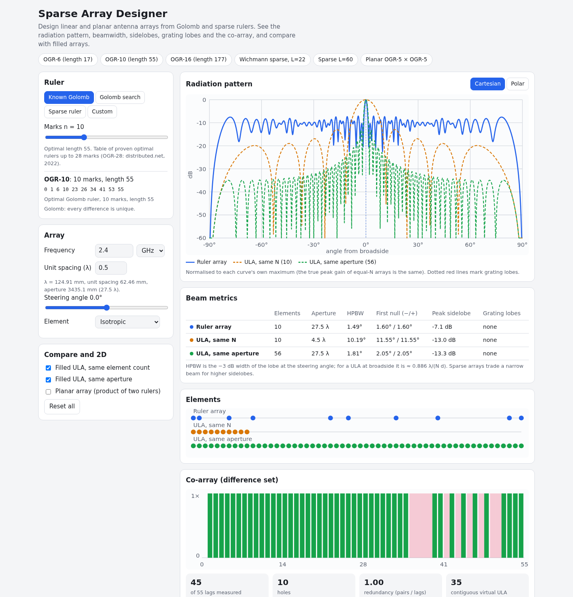

# Sparse Array Designer

Design sparse antenna arrays from Golomb rulers and sparse (minimum-redundancy) rulers. Pick a ruler, set the frequency and unit spacing, steer the beam, and see the radiation pattern, half-power beamwidth, first nulls, peak sidelobe level and grating lobes, next to a filled array with the same element count and one with the same aperture. A co-array view shows which baselines the array measures, and what virtual aperture it gives for DOA estimation and MIMO radar.

**Try it: [hermes98761234.github.io/sparse-array-designer](https://hermes98761234.github.io/sparse-array-designer/)**

[](https://github.com/hermes98761234/sparse-array-designer/actions/workflows/deploy.yml)



## Features

- **Optimal Golomb rulers up to 28 marks** (OGR-28, proven by distributed.net in 2022). Every table entry is checked in the tests to be a Golomb ruler with the documented length.
- **Sparse rulers for any length**: the Wichmann construction (with truncation and repair for lengths it does not hit exactly), and an exact minimum-marks search for lengths up to 40.
- **Search in a Web Worker**: exact branch and bound for Golomb rulers up to 12 marks (n = 11 takes seconds, n = 12 a few minutes, with cancel), and an algebraic construction plus local search for larger n.
- **Array design**: frequency in MHz or GHz, unit spacing (default λ/2), positions in mm, steering slider, isotropic, half-wave dipole or patch cos^q elements, polar and Cartesian dB plots.
- **Metrics**: HPBW, first nulls, peak sidelobe level, and a grating lobe warning that follows the steering angle.
- **Co-array**: lag coverage chart (unique lags for Golomb, full coverage for sparse rulers), redundancy, contiguous virtual ULA length, and the MIMO virtual array for Tx = Rx = the ruler.
- **Planar arrays** as the product of two rulers, with a u-v pattern map.
- **Export** element positions (CSV, mm), pattern (CSV, dB) and the pattern plot (SVG). Your settings are remembered in the browser.
- Light and dark themes, works on phones, nothing to install, no server.

## How it works

Elements sit at x_i = m_i d, where m_i are the marks of the ruler and d is the unit spacing. With u = sin θ (θ from broadside) and steering direction u₀, the array factor is

AF(u) = Σ exp(j 2π x_i (u − u₀)).

For N equally spaced elements this is the closed form sin(Nψ/2) / (N sin(ψ/2)) with ψ = 2π d (u − u₀), which the tests compare against. The broadside half-power beamwidth of a ULA is about 0.886 λ/(N d), also tested. The total pattern is |AF|² times the element power pattern.

A **Golomb ruler** has all pairwise differences distinct, so the co-array has no redundancy. The exact search tries lengths upward from the proven optimum of the shorter ruler and places marks left to right with distinct-difference bookkeeping. It prunes with the proven lengths of shorter optimal rulers and breaks the mirror symmetry. A **sparse ruler** of length L measures every distance 1..L. Wichmann's rulers W(r,s) use 4r + s + 3 marks for length 4r(r + s + 2) + 3(s + 1). Grating lobes appear where u₀ + k/(g d) is inside [−1, 1], with g the greatest common divisor of the marks.

References: B. Wichmann, "A note on restricted difference bases", J. London Math. Soc. 38 (1963); A. Moffet, "Minimum-redundancy linear arrays", IEEE Trans. Antennas Propag. 16 (1968); OEIS A003022 (Golomb rulers) and A046693 (minimal sparse rulers); distributed.net OGR project.

## Quick start

You need [Node.js](https://nodejs.org/) 22.

```bash
git clone https://github.com/hermes98761234/sparse-array-designer.git
cd sparse-array-designer
npm install
npm run dev       # http://localhost:5173
npm test          # ruler tables, search, array factor and co-array tests
npm run build     # static site in dist/
```

## License

MIT
